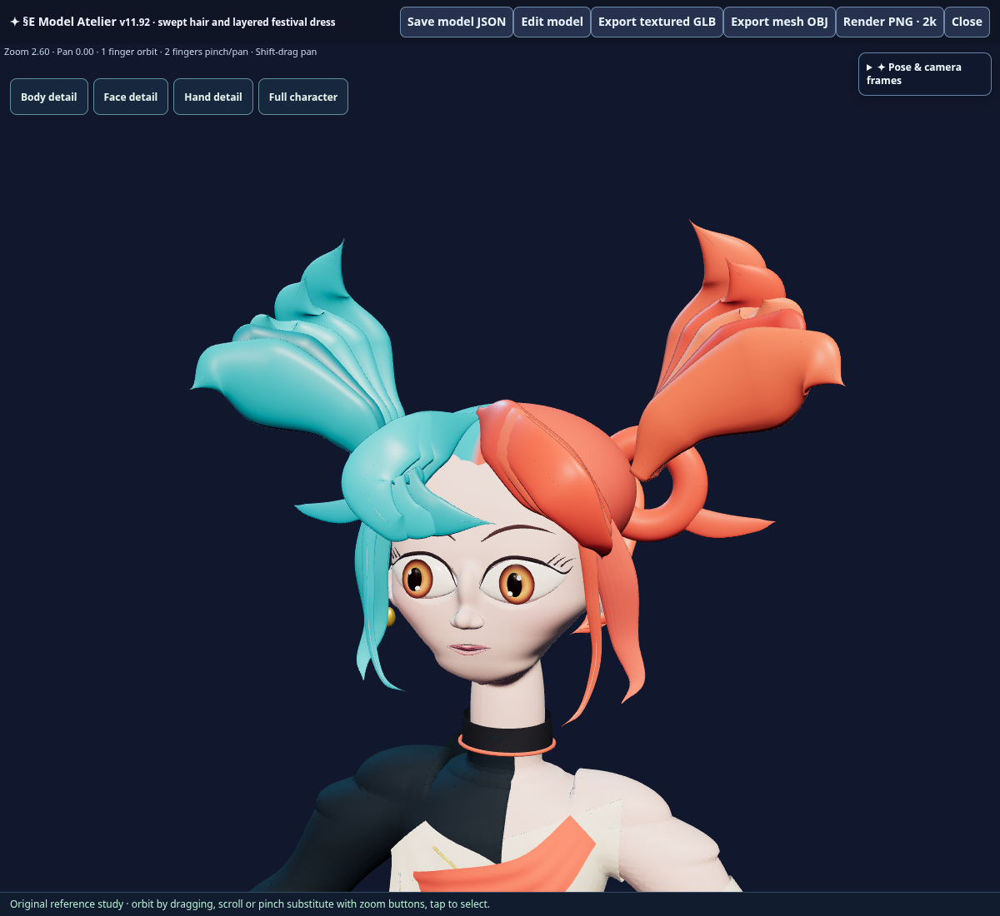
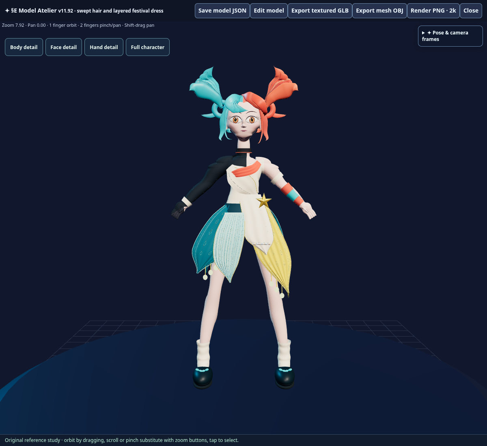

# §E v11.92 — female starter reference refinement

The owner requested matching the existing female starter's eyes, brows, chin, cheeks, hair and a longer detailed dress to supplied character images. Later close-ups clarified the soft lower face, lifted upper lashes, overlapping cyan/coral bangs and upward-tied hair silhouette. The blonde reference informs face shape; the starter retains its festival colors and outfit.

## Source ownership

The ordered v11.92 patch wraps the preserved v11.91 native creator. New face, dress and framing modules extend the existing Model Atelier owner. The new lossless payload is packaged alongside the original 283-part saved starter and the complete v11.91 scene. All 298 previous runtime/patch sources and all 64 existing packaged assets remain byte-exact. No Chat/LALM or unrelated game source is changed.

The face refinement retains the connected skin indices and body below the portrait. Rebuilt eyes, brows and swept hair stay independent editable topology meshes. Existing companion sockets, parts and assembly state remain preserved. Dress geometry extends the original panels and their matching trim, adds pleated relief, raised brocade/stitches and individual ornaments, and keeps hanging baubles round. Body/portrait framing accounts for the full new hair silhouette.

## Validation

All targeted checks passed in the cloud environment:

- v11.92 source/package verifier and generated JavaScript syntax.
- Native editor model validation, 4K image loading and front/three-quarter review views.
- Material edit changes native data; Undo restores the exact original parts.
- **178,939,550 byte** native JSON export/reimport preserves every part exactly.
- Current source factory reproduces packaged parts, selection groups and assemblies exactly.
- **59,340,464 byte** GLB contains all **325 meshes / 1,558,384 triangles**, finite geometry, valid UVs/normals/indices, body vertex colors, exact material bindings and both byte-exact embedded **4096×4096** color/normal images.
- Gold dress point extends from Y **2.16** to **1.4912**; cyan/teal layers also lengthen. Ten real ponytail tufts rise above the original crown.

Seal: **124 patches / 65 packaged assets / 6,442,424 HTML bytes**, SHA-256 `eba0e3000950a95053dc7000bf9387d89e6fefa81e7d11cacdd722f765ddf6c5`, marker `V11_92_FESTIVAL_REFERENCE`. Detailed receipts: [editor](festival_reference_v11_92_editor_receipt.json) and [GLB](festival_reference_v11_92_glb_receipt.json). Device-specific visual acceptance remains with the owner.

## Publication boundary

The dedicated §E release process applies: validated source on main, then a separate final commit changing only DEPLOY_REQUEST.json. Production success requires the exact trigger's workflow and its live HTML/source/asset verification step to complete successfully. Source validation alone is not a production receipt.

Repository Work authority: `runtime:versions/repository-work.txt` 1.0.234 → 1.0.235 (`73d401bd9dacfaf8ed830c97910da93b93989b87`). Other Chat/LALM/Server module authorities remain unchanged.
