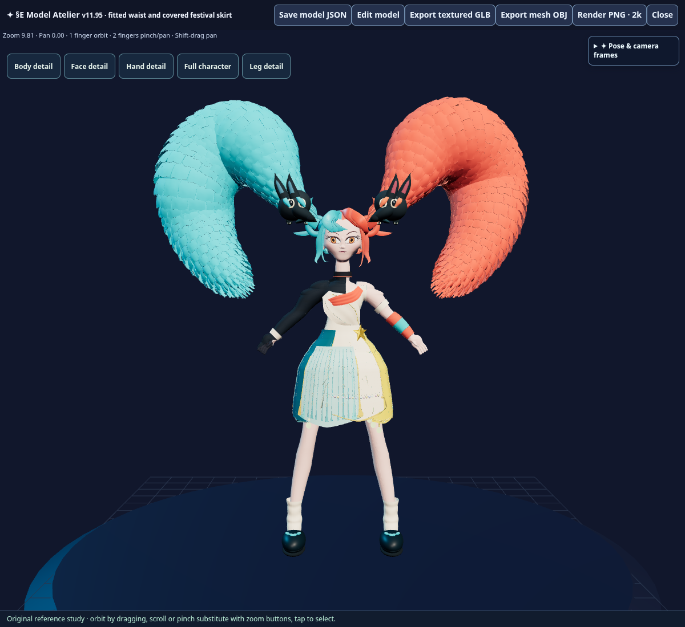
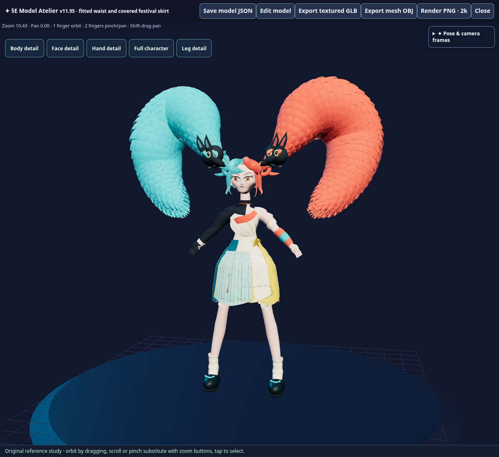
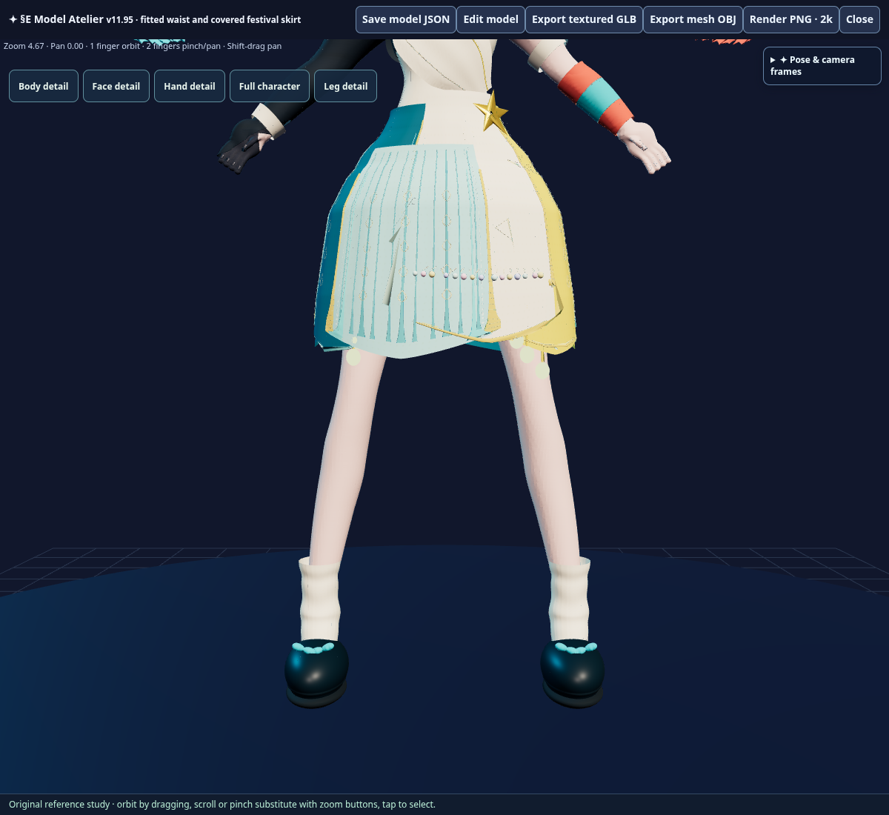
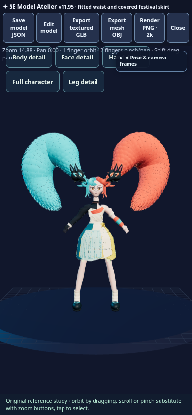

# Checkpoint §E v11.95: fitted festival skirt waist

Mode: VERIFY / HANDOFF. Lifecycle: BUILD_EVIDENCE_RECORDED / DEVICE_TEST_PENDING. Documentation gate: PASS. Source and canonical deployment are verified; owner-device waist-fit acceptance remains pending.

## Objective and success criteria

The owner reported that the v11.94 skirt was too big around the waist. Fit the upper panels to the existing bodice/skin, with a smooth upper-hip transition, preserved lower flare and no exposure. Keep anatomy, portrait, piñatas, topology and native editing/export unchanged.

## Confirmed facts, requirements and assumptions

The source uses a smooth cubic radial fit above Y2.40. Waist width at Y2.90 is reduced approximately 25%, with depth reduced 22%. Matching trim follows; upper side edges overlap to close a pre-existing gap near Y2.79. The five native waist-jewel arms now follow the fitted front. No parts are added. All body/face/leg geometry, shorts, companion meshes and assembly/socket state stay exact. Every vertex at/below Y2.40 is preserved, and actual world-space heights stay unchanged within native serialization precision. Minimum lower-piece height is 1.592134, above kneecap Y1.52.

REQUIREMENT: a visibly fitted waist, smooth flare and full coverage. ASSUMPTION: the existing body/bodice and opaque underlayer define clearance; owner-device visual acceptance follows. RECOMMENDATION: no unrelated changes.

## Sources of truth and files changed

Read `AGENTS.md`, `RELEASE_PROCESS.md` (§§§), `§tart_§E.md`, roadmap/module authorities, v11.94 runtime/native scene, manifest, packaging and dedicated workflow. No repository Constitution file was found, and the checkpoint skill's supplementary reference resources were unavailable; current repository authority governs this bounded correction.

New runtime `model_atelier_skirt_fit_v11_95.js` extends the existing factory through ordered patch `v11_95_fitted_skirt_waist.py`. New lossless scene payload, generator, focused verifier/browser/GLB checks, manifest/version identity, packaging and deployment expectations accompany it. All 312 previous runtime/patch files and 67 prior assets retain exact hashes.

## Documentation impact set

Categories: checkpoint/evidence, release note, roadmap, provenance, source packaging and Forge workflow. Updated engine README/SPACE_README/ROADMAP, root §tart_§E, server roadmap and this receipt. Protocol, identity/trust, Chat/LALM, gameplay and architecture documents intentionally stay unchanged because those behaviors are outside this correction. No new source lane, module owner or protocol is introduced.

## Verification

- `python scripts/verify_v11_95_release.py --output <dist>` and `node --check <dist>-module.mjs`: PASS. **127 patches / 68 assets / 6,501,581 HTML bytes**, SHA256 `a0d61bfac63c666ae7037edfb6b92f509abf8f7d4314615decb3b39bffa7ce8c`. Marker `V11_95_FITTED_SKIRT_WAIST`.
- Actual triangle-plane sections show the intended width/depth reductions; native UV/index arrays, transforms and all unaffected parts remain exact.
- Real editor coverage: **720/720** near-side panel rays with skin clearance; knee-height bounds, opaque underlayer and both piñatas' desktop/phone visibility PASS. Native smoke also passes 720 rays, 1,341 skin samples and 2,605 underlayer samples, with minimum measured clearances 0.02577 / 0.00405.
- Skirt material edit/Undo and **201,481,359-byte** native JSON save/import restore exact parts. The current factory exactly reproduces packaged parts, groups and assemblies.
- Actual **64,847,940-byte** textured GLB retains 327 meshes / 1,755,616 triangles, valid finite positions/normals/UVs/indices and both exact 4096×4096 maps. No browser page errors.
- Harness repair: an early browser run was intentionally stopped while replacing local-Y comparison with world-Y comparison for rotated jewel parts and extending upper-side coverage rings. No model/source repair or integrity bypass was used for that harness correction.

[Editor receipt](fitted_skirt_v11_95_editor_receipt.json) · [GLB receipt](fitted_skirt_v11_95_glb_receipt.json) · [Native coverage](fitted_skirt_v11_95_native_metrics.json)

## Package, provenance and lineage

Canonical engine package: versioned native scene plus sealed HTML/SOURCE manifest; Android/source-ZIP promotion is not applicable. Engine v11.94→v11.95; Repository Work 1.0.237→1.0.238 at `21711cf03483d8bb95d233775a6de1316e10ff6b`. Chat/AI, Server Runtime, LALM, model weights and gameplay do not advance. Historical payload/source lineage remains.

## Build, device evidence and disposition

Baseline v11.94 source `b11cda1a89bef9b38a16de88a45a98ca84e3d2bc`, trigger `ed254935daf19d827a3dabea29930faa9d996a29`, [run 40043264773](https://github.com/kaministrator999-ui/Swrlzkamico/actions/runs/40043264773): COMPLETED/SUCCESS with exact hosted HTML/SOURCE/all 67 assets. Owner waist-fit feedback is the carried-forward refinement, addressed in this source candidate.

v11.95 local source/editor/export verification was completed before publication under [§§§](../RELEASE_PROCESS.md); observed hosted evidence follows below. Physical owner-device acceptance remains pending and is not inferred from CI. Additional approval: NOT APPLICABLE within the existing owner-directed correction/release loop. No further implementation checkpoint is started by this receipt.

## Observed publication and checkpoint closure

Observed `2026-10-24T00:55:34.789423+00:00`: [dedicated deployment 40047207802](https://github.com/kaministrator999-ui/Swrlzkamico/actions/runs/40047207802) completed **SUCCESS** on exact trigger `75ed04af5e4c7316ca53df5561daacd2051500ab` after source `41b795a82118acdd093727610bc5685181160be3` was published. The named live-verification step succeeded and confirmed exact hosted v11.95 HTML, SOURCE receipt and all 68 assets against the 127-patch seal, **6,501,581 bytes**, SHA256 `a0d61bfac63c666ae7037edfb6b92f509abf8f7d4314615decb3b39bffa7ce8c`. [Machine-readable deployment evidence](fitted_skirt_v11_95_deployment_receipt.json).

This documentation-only closure records the actual build/runtime evidence without changing the engine artifact or its version. Repository Work remains 1.0.238 for this same bounded checkpoint. The waist-fit issue has an implemented, locally tested and live-verified correction; physical owner-device visual acceptance remains pending. Approval waiting: NOT APPLICABLE; next evidence is owner feedback from the live model. No further implementation is started.
