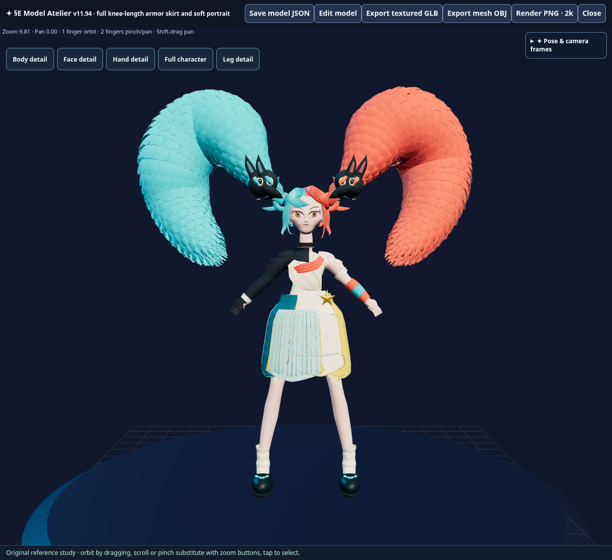
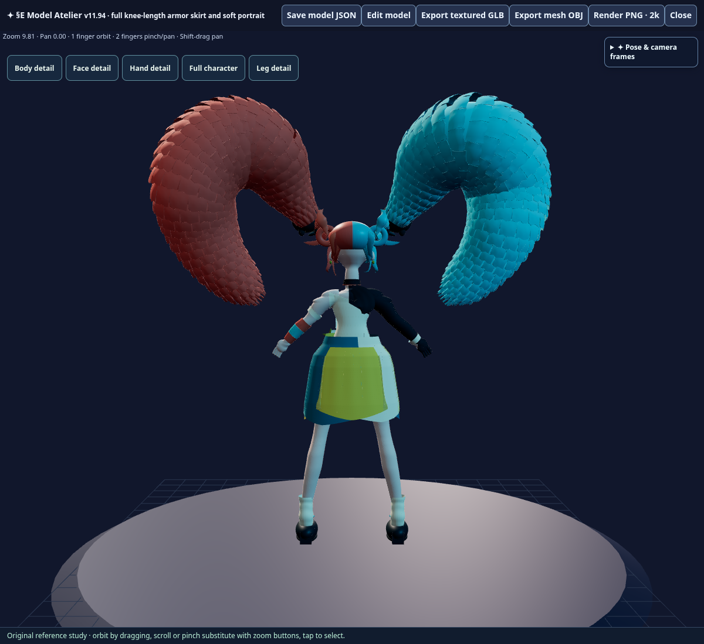
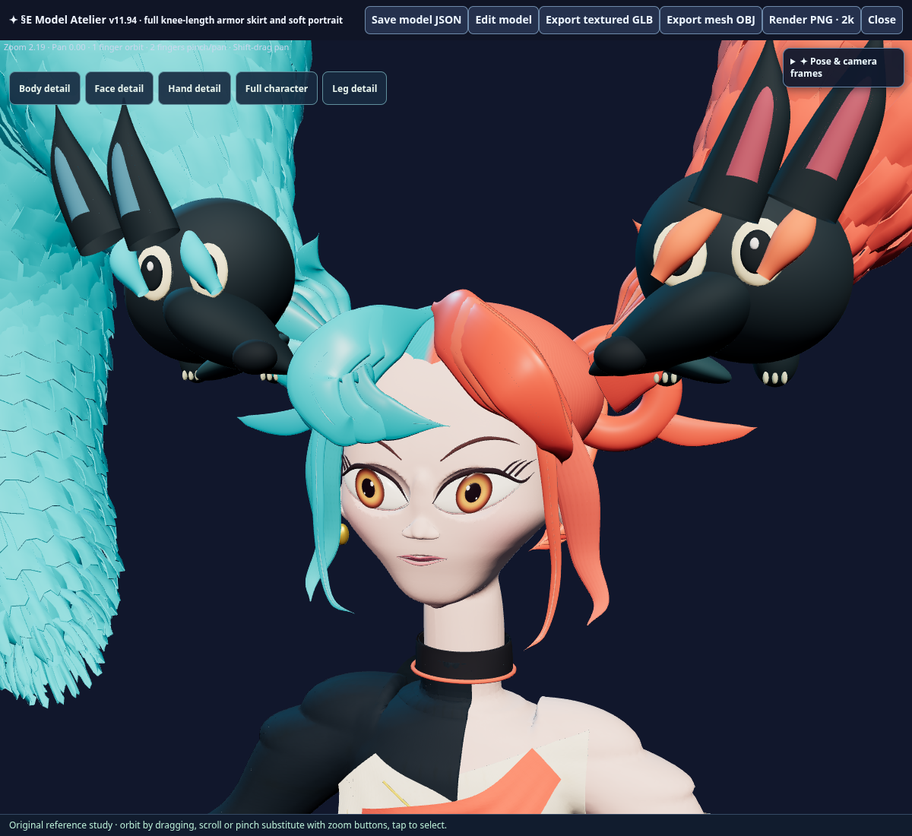
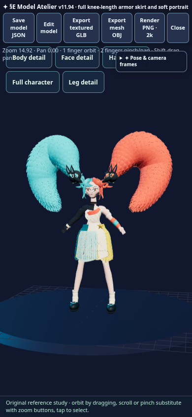

# §E v11.94 — full festival armor skirt and softer portrait

The nine existing lower armor/cloth panels now overlap around the hips and thighs, forming a continuous festival skirt with the original teal, ivory, cyan and gold layers. Matching piping, inset pleats, embroidery, running stitches and hanging ornaments follow the new panel surfaces. Every affected lower piece ends above the actual kneecap landmark Y=1.52; measured minimum is **1.592134**. The unchanged fitted opaque shorts retain coverage underneath and from below.

The head is 5% narrower, blended smoothly above the unchanged neck. Facial overlays and hair follow the contour; piñata bun/grip owners and all companion meshes/socket assemblies remain byte-exact. The nose uses a smooth bridge/tip depth reduction, bounded surface smoothing and a focused alar/underside finish. Existing connected skin indices and all native UV arrays remain exact.

## Validation

- Source build, generated module syntax and sealed manifest pass: **126 patches / 67 assets / 6,495,464 HTML bytes**, SHA-256 `ede8f335dc9f9086d5d6f1ec6abf7d73711aa56bf3ea123c7494af2daac5d78c`; marker `V11_94_KNEE_SKIRT_SOFT_PORTRAIT`.
- All 309 previous runtime/patch sources, 66 previous assets and 117 companion meshes remain exact. Every part retains indices/UVs/transforms; lower-body skin, smooth calves, opaque shorts and previous fitted armor remain unchanged.
- Real editor tests pass on desktop and phone: both original 28-mesh piñatas remain visible and framed; front/back/left/right views retain them.
- All **216** actual near-side skirt rays pass over 72 azimuths at three heights. Armor intercepts before the body wherever skin intersects; minimum sampled clearance is **0.139226**. Six pelvis coverage rays and sixteen fitted-armor rays pass.
- Actual native head width ratio **0.950**. Bridge and tip relief, nasal finish and orientation checks are recorded in the [portrait metrics](knee_skirt_v11_94_portrait_metrics.json).
- Native material edit/Undo is exact. JSON save/import preserves all geometry and materials (**201,471,914 bytes**). Current source factory exactly reproduces packaged parts, mesh groups and assemblies.
- Textured GLB passes finite positions/normals/UVs/indices, exact embedded 4096×4096 maps and material checks: **64,847,948 bytes**, **327 meshes / 1,755,616 triangles**. Opaque double-sided underlayer preserved. Browser page errors: zero.

[Editor receipt](knee_skirt_v11_94_editor_receipt.json) · [GLB receipt](knee_skirt_v11_94_glb_receipt.json)

## Delivery

Repository Work 1.0.236 → 1.0.237 at `ced76e1b1e49f36d054f3591cf9a446829d774c7`. Chat/AI, Server Runtime, LALM, gameplay and model weights are unchanged. Local source/editor/export validation is complete. The separate final DEPLOY_REQUEST-only commit follows ordinary source publication on main. The dedicated workflow must confirm exact hosted HTML, SOURCE receipt and all 67 assets before this release is called live. Owner-device visual acceptance follows publication under [§§§](../RELEASE_PROCESS.md).
