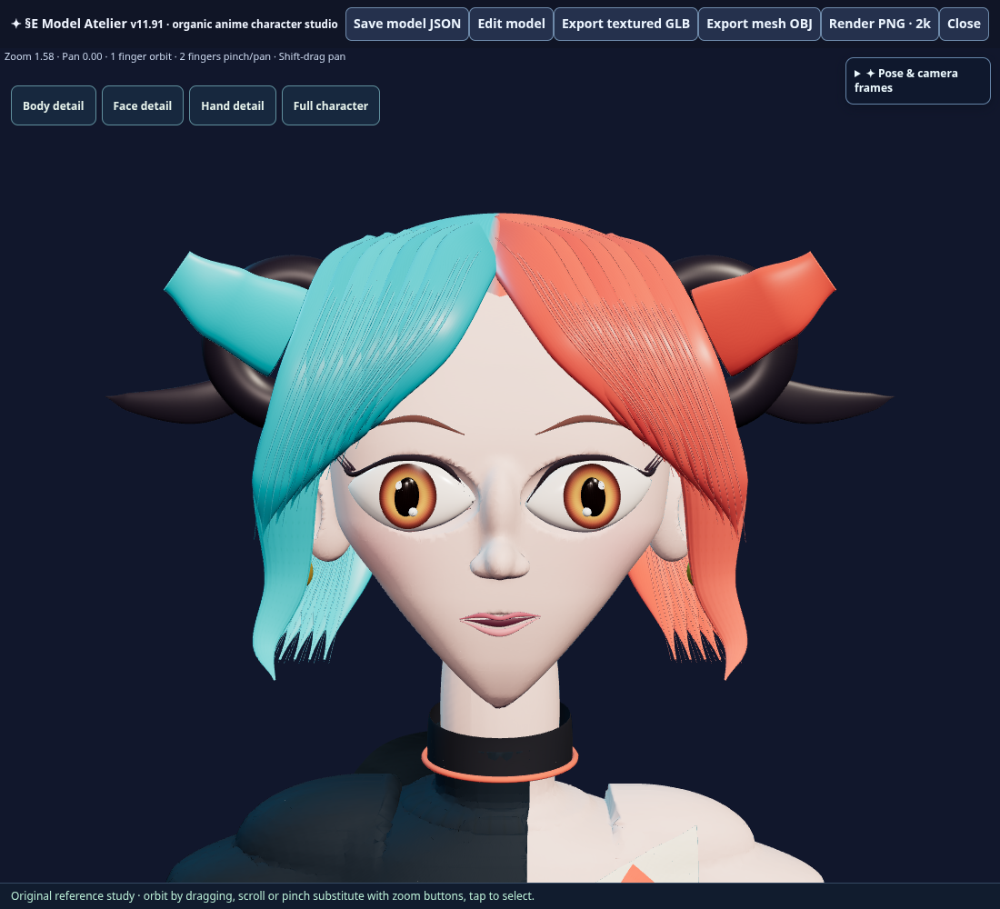
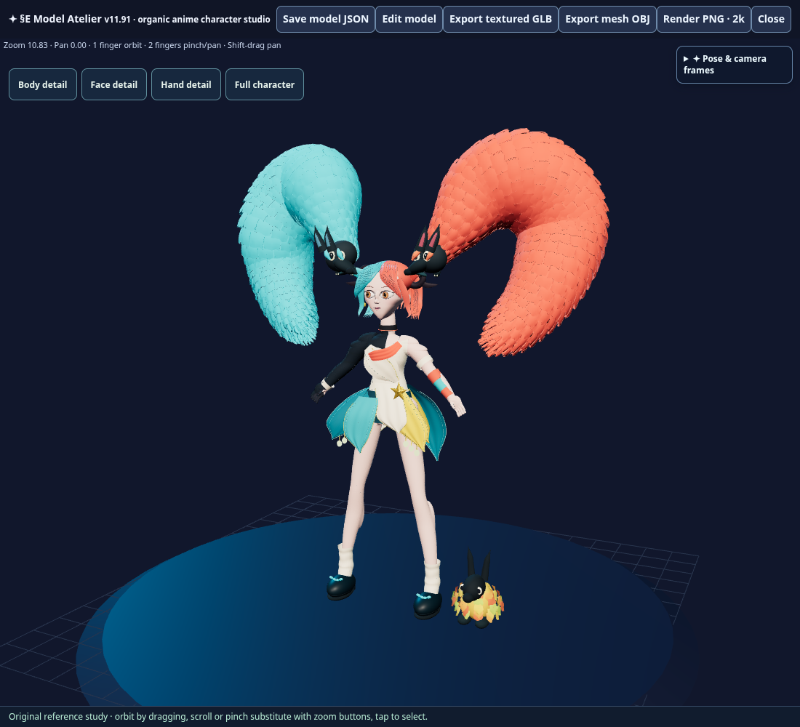

# §E v11.91 — Organic anime girl and preserved original

The girl starter now has a continuous organic anatomical surface and a more strongly inward-tapering jaw with a narrow, rounded chin. The pre-change 283-part starter is saved as an independent native project. The existing asymmetric outfit, cyan/coral hair, two paper-ferret companions and bunny remain available in the new sculpt.

## Open and edit

- New sculpt: `?project=organic-anime-girl`, or the **Prism · Organic Anime Girl** project card. `?project=model-atelier` uses this version too.
- Original: `?project=festival-girl-saved`, or **Saved Festival Girl · v11.90**.
- **Body detail**, **Face detail**, **Hand detail**, and **Full character** control inspection. Detail views isolate the character in the viewport; complete JSON/GLB export still includes companions.
- **Edit model** exposes native topology/component, sculpt, group, transform, material and Undo controls.

## Authored geometry and materials

The skin contains **254,588 welded vertices / 509,172 triangles** in **one closed connected component**. Every mesh edge has exactly two incident faces. Head, ears, neck, trunk, arms, all ten fingers, legs and feet join continuously. Adaptive face/finger refinement is conforming; all vertices are projected onto the same anatomical field. Monotone curved sections avoid abrupt rings between jaw/limb sections. The face includes orbital wells, cheek/jaw planes, a nasal bridge and smaller nasal tip, fitted eye whites, amber radial irises, independent pupils, lids, lashes and lip rolls. Both complete eye assemblies tilt six degrees upward toward the outer corners (↖️ ↗️), including brows and highlights; the orbital wells follow the same cant. Legs include knees, rear calves and Achilles transitions.

The complete model contains **353 editable topology meshes / 1,634,372 rendered triangles**. It retains the festival design and companions, adding 72 tapered 3D hair filaments, ten nail plates, knuckle folds, raised garment stitches, and closed sleeve/yoke/bodice shells fitted to the anatomical surface. Thin hair filaments use simple physical color to avoid dense atlas sampling on tiny geometry. Dedicated deterministic **4096×4096 color and normal atlases** provide restrained skin pores, flowing hair, woven/embroidered cloth, leather grain, engraved metal and radial iris fibers. Atlas editing preserves `festival-4k` bindings.

This is a detailed authoring sculpt. Hair, clothing and accessories remain separate editable surfaces; skeletal weights/animation retopology are not introduced. The sculpt uses on-demand rendering while idle. Native import supports JSON below 256 MB and per-part topology up to 300,000 vertices / 600,000 triangles. The exact native factory is exposed as `SWYRL_ENGINE_MODEL_ATELIER.createGirlProject()`.

The original scene is retained losslessly in `payload/festival-girl/saved-v11-90.swyrl.json.gz`. The new saved scene is losslessly compressed and divided into transport-size `.gz.part00`–`.gz.part02` source chunks; packaging concatenates them before decompression. This changes no native scene bytes. The actual editor's native field/sweep/cloth tools generate the scene; the payload is not an external imported character.

## Targeted verification

- `verify_v11_91_release.py`: original snapshot equals the previous canonical constant; all 294 historical runtime/patch files and 60 packaged assets preserve exact bytes; native bounds/finite coordinates/indices and new part limits pass; the full skin is closed and connected.
- Actual Chromium editor: loads all 353 meshes and both real 4K maps; five detail views render; both sclera outer corners rise measurably; versioned update panel has the correct version and five notes; native material editing and Undo restore exact part data.
- Actual JSON export/import: **186,986,082 bytes**, exact part equality after reopening.
- Actual textured GLB: **61,491,476 bytes**, all 353 meshes and 1,634,372 triangles. Independent binary inspection validates finite positions/normals/UVs/colors, legal indices, body vertex colors, both embedded 4096px images byte-for-byte, and saved material bindings.
- A fresh call to the actual native factory reproduces all parts, mesh groups and socket/motion assemblies exactly. The saved original reopens with 283 parts. No page errors.
- The complete built module passes `node --check`; all five deployment workflow Python blocks parse. The actual expected asset-set and version/HTML alignment blocks pass locally. No unrelated starter suite was run.

Machine-readable evidence: [targeted results](../tests/organic_anime_girl_v11_91.results.json).

## Source seal and delivery

**123 patches / 64 packaged assets**; HTML **6,421,818 bytes**; SHA-256 **`ba0105f62f2e7451d4e78148cae425f4ce5e3684093fc3954d3c1f0e1105b934`**; marker **`V11_91_ORGANIC_ANIME_GIRL`**. The dedicated workflow rebuilds the exact source, checks the seal and verifies the entire served asset receipt. Delivery follows the source commit with a separate `DEPLOY_REQUEST.json`-only trigger commit. Owner-device appearance and interaction acceptance follows publication.
