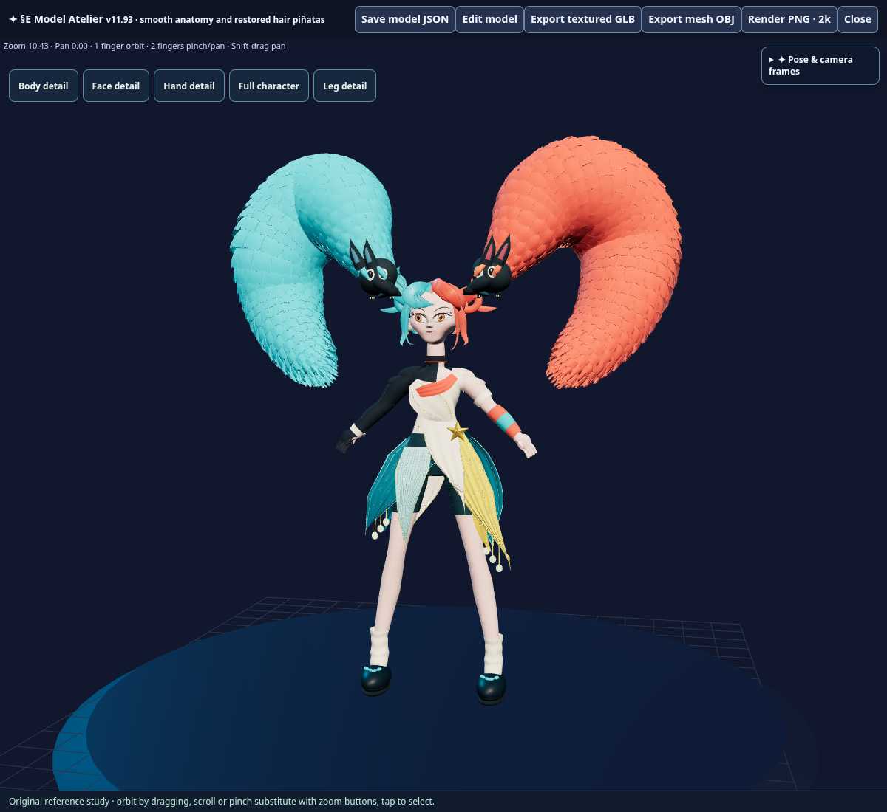
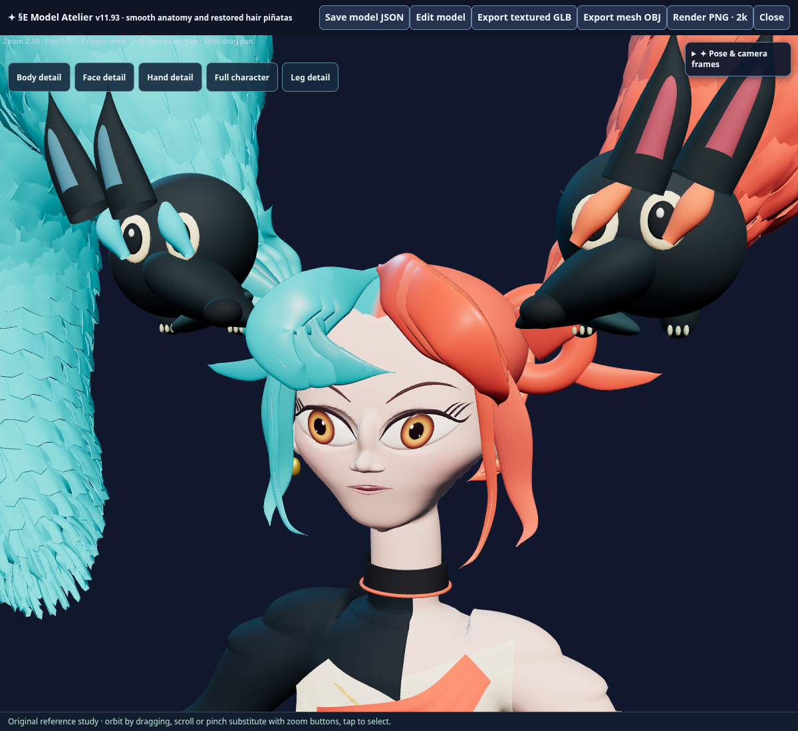
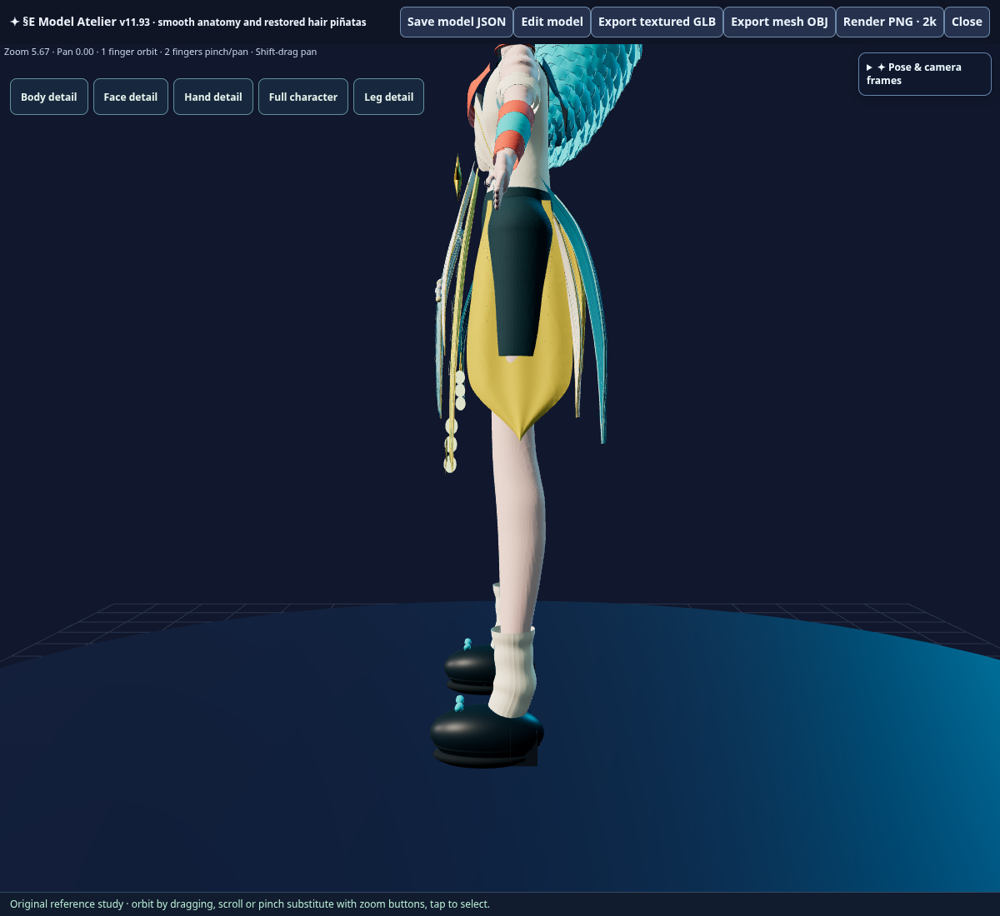
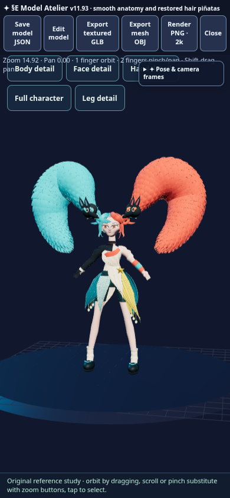

# §E v11.93 — anatomy, visible piñatas and costume coverage

Owner feedback requested more work across the model: keep both hair piñatas, make the eyes rise from low inner corners, smooth exposed skin into muscle forms, blend legs smoothly into calves, smooth the cheeks/chin, and prevent armor poke-through and crotch exposure.

The visibility regression was caused by body/portrait camera code hiding every non-Character group despite retaining the native piñata meshes. The new presentation keeps both 28-mesh attached groups visible and fits them in the default camera. Tests must inspect real visibility and viewport inclusion, including the phone opening view; retained scene data alone is insufficient.

The native creator extends preserved v11.92 source with original connected-skin portrait refinement, regional volume-preserving skin finishing, continuous calf profiles, compact hair and sharper skirt panels. The existing festival shorts and armor/cuff owners receive fitted opaque geometry. All 117 companion meshes/assembly state and both original restored grip meshes remain preserved. No Chat/LALM source or unrelated game logic is changed.

## Validation

All targeted checks passed:

- Source seal, generated JavaScript syntax, 302 previous runtime/patch sources and all 65 previous packaged assets byte-exact.
- All 117 companion meshes and assembly state byte-exact; both original grip meshes restored exactly from v11.91.
- Both 28-mesh hair piñatas actually visible and in the default viewport on desktop and 390×844 phone, and remain visible through body/face/hand/full view changes.
- Original closed connected body indices preserved. Measured head, arm and leg vertex changes; the eyes have **0.045876** vertical corner rise over .184 width (14°). Calf sections taper continuously from upper calf through knee/ankle.
- Upper-body skin local Laplacian RMS **0.00332040→0.00091645**, with bounded displacement and orientation guard. Body normal-map strength .03; fitted sleeve/bodice/yoke rebuilt from finished skin.
- Opaque double-sided festival shorts intercept skin from **six front/back/side/below directions**; **16 front/back armor samples** intercept before skin across six cuffs/collar and the bodice/yoke. The linings follow the original diagonal armor hem planes.
- Material editing changes the native model; Undo restores exact parts. **201,451,519 byte** JSON save/import is exact. Current source factory matches packaged parts, groups and assemblies.
- **64,847,952 byte** GLB contains all **327 meshes/1,755,616 triangles**, valid finite positions/UVs/normals/indices, body colors, exact material bindings and both exact embedded 4096×4096 images. Shorts stay opaque and double-sided in GLB.

Release: **125 patches/66 assets/6,477,235 HTML bytes**, SHA-256 `caad492d5e7ee95808c36102b47b24fcff816c340f242f9db1fc5d24a4316cf6`, marker `V11_93_SMOOTH_ANATOMY_PINATAS`. Receipts: [editor](smooth_pinatas_v11_93_editor_receipt.json), [GLB](smooth_pinatas_v11_93_glb_receipt.json). These checks validate this source and pose; owner-device visual acceptance follows publication.

## Publication

Use the separate final DEPLOY_REQUEST-only commit after validated source is published to main. The final handoff must report the exact workflow and its served-package verification. Owner-device visual acceptance follows publication.

Repository Work 1.0.235→1.0.236 on runtime commit `f7cf6a42b9d3dade422edebab130a8a7f639e937`; other Chat/LALM/Server authorities unchanged.
